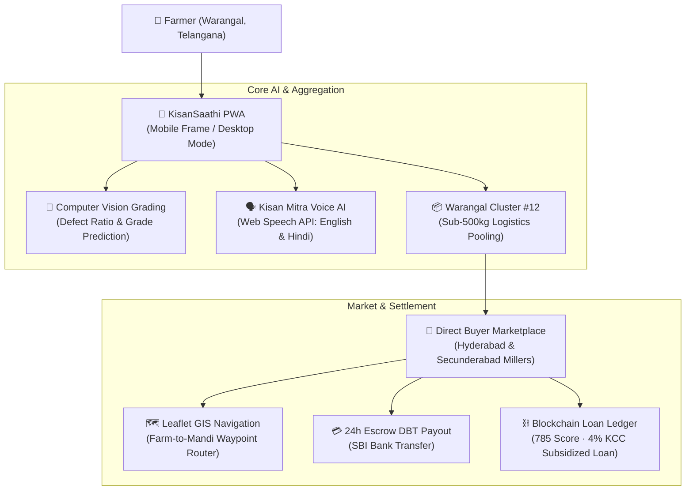

# 🌾 KisanSaathi (किसान साथी)

[](https://vercel.com/new)


> **Empowering Farmers with Direct Mandi Access, Computer Vision Quality Grading & Cluster Logistics.**  
> Developed for **Telangana** (Warangal, Medchal, Hyderabad, Secunderabad, Nizamabad) by **Team ForeverKnights**.

---

## 📌 Table of Contents
- [Overview](#-overview)
- [Key Features](#-key-features)
- [System Architecture](#-system-architecture)
- [Project Directory Structure](#-project-directory-structure)
- [Quick Start & Local Development](#-quick-start--local-development)
- [1-Click Vercel Deployment](#-1-click-vercel-deployment)
- [HACK-X Pitch Deck & Documentation](#-hack-x-pitch-deck--documentation)
- [Team ForeverKnights](#-team-foreverknights)
- [License & Acknowledgments](#-license--acknowledgments)

---

## 🌟 Overview

Smallholder farmers in India lose **15% to 20%** of their total revenue to commission agents, face arbitrary quality grading cuts at physical mandis, and incur unaffordable freight costs when transporting sub-500kg harvest batches.

**KisanSaathi** is a full-featured agricultural marketplace and value-addition platform that:
1. **Eliminates Middlemen**: Direct buyer negotiation with guaranteed 24-hour DBT escrow payouts.
2. **Standardizes Quality with AI**: Client-side Computer Vision grades grain uniformity into *Elite*, *Premium*, and *Classic* tiers.
3. **Reduces Freight by 38%**: Automated **Cluster Aggregation Engine** pools sub-500kg yields into shared logistical runs (e.g., *Warangal Agri-Cluster #12*).
4. **Bilingual Accessibility**: Voice-enabled **Kisan Mitra AI Assistant** supporting both **English (`en-IN`)** and **Hindi (`hi-IN`)**.
5. **Agri-Credit Financial Inclusion**: Blockchain-backed transaction ledger generating a 785/900 credit rating that unlocks 4% subsidized crop loans.

---

## 🚀 Key Features

| Feature Module | Description | Technical Implementation |
| :--- | :--- | :--- |
| 🔐 **Farmer Authentication** | Dual-mode login: 10-digit Mobile OTP (demo code `1234`) or 1-Click Quick Farmer access (*K. Ramarao Reddy*). | Client-side Session State with `localStorage` persistence |
| 🔬 **AI Quality Grading** | Automatic grain defect and uniformity analysis recommending fair price bands (₹/Kg). | Browser-based Computer Vision inference models |
| 🤝 **Price Negotiation Desk** | Wholesale millers and buyers place live counter-offers; farmers accept or decline with 1 tap. | Real-time negotiation desk & transaction engine |
| 📦 **Cluster Aggregation** | Sub-500kg crops are recommended to join local farmer pools (*Warangal Cluster #12*). | Algorithmic harvest pooling & freight optimization |
| 💳 **Escrow Wallet** | Escrow funds released upon verified delivery with instant simulated SBI bank payout. | Escrow vault ledger with IMPS/NEFT simulation |
| 🗺️ **GIS Route Tracking** | Interactive map tracing transit routes from Geesugonda, Warangal to Bowenpally Mandi, Secunderabad. | Leaflet.js with live polyline navigation & Google Maps link |
| 🤖 **Bilingual AI Voice Chat** | Voice assistant answering queries on Telangana mandi rates, organic Neemastra spray, and schemes. | Web Speech Synthesis API (`en-IN` & `hi-IN`) |
| 🧪 **Soil Testing Directory** | Authorized government labs across Warangal, Medchal, Hyderabad, Secunderabad, and Nizamabad. | `labs.json` directory with 1-click calling & filtering |
| ⛅ **Agro-Weather Advisory** | Live micro-climate weather updates and agricultural advisories for Telangana districts. | Dynamic agro-meteorological presets & advisory engine |

---

## 🏗️ System Architecture



---

## 📂 Project Directory Structure

This repository is organized to deploy directly to **Vercel** with zero configuration while preserving mobile sources, pitch decks, and architecture documentation:

```
KisaanSaathi/
├── .gitignore                   # Comprehensive Git ignore rules
├── vercel.json                  # Production Vercel deployment configuration
├── package.json                 # Project manifest with build and start scripts
├── server.js                    # Zero-dependency Node.js HTTP static server
├── index.html                   # Core web entrypoint (auto-detected by Vercel)
├── styles.css                   # Responsive mobile-frame & portal styling
├── app.js                       # Controller: bilingual AI chat, OTP auth, Leaflet GIS
├── data.js                      # Data store: Telangana mandis, crops, Team ForeverKnights
├── assets/                      # Production static assets
│   ├── data/
│   │   └── labs.json            # Real Telangana Government Soil Testing Labs
│   ├── images/                  # Platform SVG icons & showcase screenshots
│   ├── raw/                     # Crop photos & advisory illustrations
│   └── team/                    # Team contributor avatars
├── web-platform/                # Standalone copy of the web portal
├── mobile-source/               # Android Native Application
│   ├── KisanSeva2-master/       # Android Studio project source (Java/Kotlin)
│   ├── KisanSeva2-master.zip    # Compressed Android source archive
│   └── KisanSeva2 - Smart India Hackathon Agricultural Platform.pdf
├── presentation/                # Hackathon Pitch Decks & Slide Assets
│   ├── KisanSaathi_HACK-X_Pitch_Deck.pptx  # Editable PowerPoint (Official HACK-X 6-slide deck)
│   ├── KisanSaathi_HACK-X_Pitch_Deck.md    # Markdown pitch deck & 3-minute pitch script
│   └── KisanSaathi Hackathon Deck.pdf      # Complete presentation deck
├── app-screenshots/             # High-Resolution UI Showcase
│   ├── 01_Farmer_Profile_CreditScore_785.jpg
│   ├── 02_KisanMitra_Bilingual_AI_Chat.jpg
│   ├── 03_Godowns_Warehouses_Directory.jpg
│   └── 04_Advisory_Information_Hub.jpg
├── docs/                        # Architecture & Technical Documentation
│   ├── ARCHITECTURE.md          # Technical architecture & subsystem flowcharts
│   └── DEPLOYMENT.md            # Vercel, Netlify, and GitHub Pages deployment guide
├── LICENSE                      # MIT Open Source License
└── README.md                    # Project documentation
```

---

## ⚡ Quick Start & Local Development

### Prerequisites
- [Node.js](https://nodejs.org/) (version 16 or newer)

### Run Locally
```bash
# 1. Clone the repository
git clone https://github.com/<your-username>/KisaanSaathi.git
cd KisaanSaathi

# 2. Start the local server
npm start
# (or directly: node server.js)

# 3. Open in your browser
# http://localhost:3000
```

> **Direct LAN Access**: To preview on your smartphone or test with nearby teammates on the same Wi-Fi network, navigate to `http://<your-local-ip>:3000`.

---

## 🌐 1-Click Vercel Deployment

Deploying **KisanSaathi** to Vercel takes less than **30 seconds**:

1. Push your repository to **GitHub**.
2. Open your [Vercel Dashboard](https://vercel.com/dashboard) and click **"Add New..."** ➔ **"Project"**.
3. Import your `KisaanSaathi` repository.
4. Keep the default settings (**Root Directory**: `./`, **Framework Preset**: `Other`).
5. Click **"Deploy"**.

Vercel will automatically read `vercel.json`, deploy your root static files, and provide an instant production HTTPS URL (e.g., `https://kisaansaathi.vercel.app`).

---

## 📊 HACK-X Pitch Deck & Documentation

The project includes presentation materials adhering to the official **HACK-X Project Presentation Format** (SU Knowledge Hub Foundation):
- **Editable PowerPoint Presentation**: [`presentation/KisanSaathi_HACK-X_Pitch_Deck.pptx`](presentation/KisanSaathi_HACK-X_Pitch_Deck.pptx)
- **Markdown Slide Deck & Talking Points**: [`presentation/KisanSaathi_HACK-X_Pitch_Deck.md`](presentation/KisanSaathi_HACK-X_Pitch_Deck.md)
- **Detailed System Architecture**: [`docs/ARCHITECTURE.md`](docs/ARCHITECTURE.md)
- **Comprehensive Deployment Guide**: [`docs/DEPLOYMENT.md`](docs/DEPLOYMENT.md)

---

## 👥 Team ForeverKnights

Developed by **Team ForeverKnights**:

| Contributor | Role & Specialization | Focus Areas |
| :--- | :--- | :--- |
| **Gulam Waheed Mujtaba** | **Lead Architect & Full Stack Lead** | PWA Architecture, Escrow Engine, Leaflet GIS Waypoint Routing |
| **Shaik Mohammed Ateeq** | **Cloud Infrastructure & AI Systems Engineer** | Bilingual NLP Assistant, Web Speech API, Cloud DevOps |
| **Malik Samiullah Khan** | **UI/UX & Agricultural Tech Specialist** | Farmer-Centric UX, Computer Vision Grading Models, Agronomic Research |

---

## 📜 License & Acknowledgments

- **License**: Released under the open-source [MIT License](LICENSE).
- **Domain Partners & Research References**:
  - *Prof. Jayashankar Telangana State Agricultural University (PJTSAU), Rajendranagar*
  - *ICAR - Central Research Institute for Dryland Agriculture (CRIDA), Hyderabad*
  - *Department of Agriculture & Farmers Welfare, Government of Telangana*
  - *Telangana State Warehousing Corporation (TSWC)*
