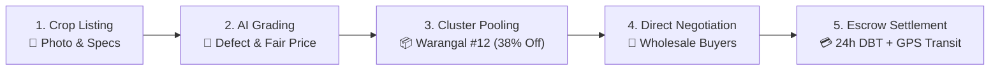
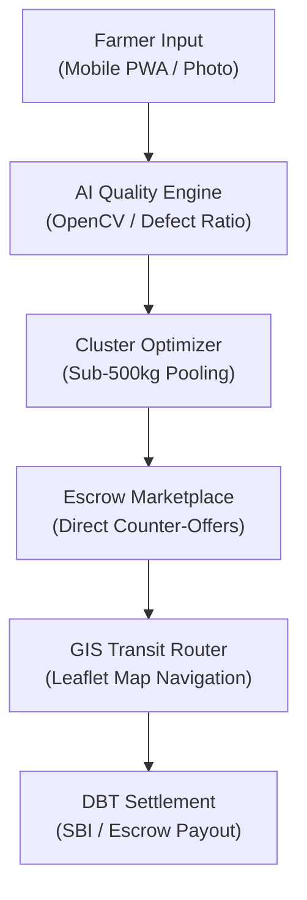

# 🌾 KisanSaathi (किसान साथी) · HACK-X 2026 Pitch Deck
**Theme:** Agriculture, FoodTech & Rural Development  
**Team:** Team ForeverKnights · **Format:** Official SU Knowledge Hub Foundation 6-Slide Limit

---

## 🖥️ SLIDE 1: Title & Team Details

### Header Banner
> **HACK-X 2026 · 35-Hour Hackathon · MJCET**

### Project Identity
- **Project Name:** **KisanSaathi** (किसान साथी)
- **Tagline:** *Empowering Farmers with Direct Mandi Access, Computer Vision Quality Grading & Cluster Logistics.*

### Problem Statement
> Smallholder farmers in Telangana lose **15% to 20%** of their produce value to intermediary commissions, face arbitrary quality grading cuts at physical mandis, and incur unaffordable freight costs for sub-500kg harvest batches.

### Project Metadata
| Field | Value |
| :--- | :--- |
| **Theme** | Agriculture, FoodTech & Rural Innovation |
| **Regional Focus** | **Telangana** (Warangal, Medchal, Hyderabad, Secunderabad, Nizamabad) |
| **Live Prototype** | Full-Stack PWA · Bilingual Voice AI · Leaflet GPS Tracking · Escrow Wallet |

### Team Details: `Team ForeverKnights`
1. **Gulam Waheed Mujtaba** — *Lead Architect & Full Stack Lead*  
   *PWA Architecture · Escrow Engine · Leaflet GIS Transit Routing*
2. **Shaik Mohammed Ateeq** — *Cloud Infrastructure & AI Systems Engineer*  
   *Bilingual NLP Assistant · Speech APIs · Scalable Cloud DevOps*
3. **Malik Samiullah Khan** — *UI/UX & Agricultural Tech Specialist*  
   *Farmer-Centric UX · Quality Grading Models · Agronomic Research*

---

## 💡 SLIDE 2: Proposed Solution & Unique Value Proposition

### 5-Step Core Workflow


### Traditional Mandi System vs. KisanSaathi
| Evaluation Parameter | Traditional Mandi Channel | KisanSaathi Solution |
| :--- | :--- | :--- |
| **Intermediary Commissions** | 12% – 18% cut taken by middlemen & brokers | **0% Commission** (Direct farmer-to-buyer escrow) |
| **Produce Quality Grading** | Subjective visual bias by trader | **Computer Vision automated grading** (Elite/Premium) |
| **Freight & Transportation** | Unaffordable individual transport (₹3.80/Kg) | **Cluster Pooling** cuts cost to ₹2.35/Kg (**38% savings**) |
| **Payment Settlement** | Delayed 15–45 days via informal credit | **Guaranteed 24-Hour DBT** direct bank transfer |

### Core USP
> *"Don't just list crops. Guarantee fair grading, shared logistics, and verified payment."*
- **Telangana Sona (RNR 15048)** premium price realization (GI 51 low-glycemic rice).
- **Warangal Agri-Cluster #12** automatic sub-500kg harvest pooling.
- **Soil Health Card Integration** connecting farmers directly to government testing labs.

---

## ⚙️ SLIDE 3: Technical Approach & Architecture

### System Architecture Pipeline


### Full Tech Stack Breakdown
| System Layer | Technologies Used | Operational Functionality |
| :--- | :--- | :--- |
| **Frontend UI** | PWA, HTML5, Tailwind CSS, Lucide | Dual responsive mode: Native Mobile frame & Desktop portal |
| **Backend Server** | Node.js Zero-Dependency Server | Static asset streaming, OTP verification, local state sync |
| **AI / Computer Vision** | Client-Side CV Inference Models | Grain defect ratio analysis, moisture rating, automated grading |
| **Conversational NLP** | Kisan Mitra (Web Speech API) | Bilingual voice synthesis (`en-IN` & `hi-IN`) with agro-advisories |
| **GIS Mapping** | Leaflet.js & OpenStreetMap | Waypoint transit navigation: Geesugonda (Warangal) ➔ Bowenpally |
| **Blockchain Credit** | Cryptographic Ledger Simulation | Agri Credit Score (785/900) & 4% Subsidized Crop Loan registry |

---

## 📊 SLIDE 4: Feasibility and Viability

### Three Viability Pillars
- **Technical Viability:** Zero-install PWA running directly in modern browsers; client-side CV execution minimizes bandwidth demands on rural 2G/4G networks.
- **Economic Viability:** 100% free listing for smallholder farmers; sustainable revenue model based on 1.5% transaction convenience fee on corporate bulk orders.
- **Operational Scalability:** Pre-integrated with Telangana State Warehousing Corporation godowns and district soil testing facilities.

### Risk & Challenge Mitigation Matrix
| Identified Risk / Challenge | KisanSaathi Mitigation Strategy |
| :--- | :--- |
| **Digital Literacy & Language Gaps** | Bilingual voice assistant (Hindi & English) with intuitive 1-tap OTP and Quick Demo access. |
| **Fragmented Harvests (<500 Kg)** | Automated cluster recommendation pooling local farmers to command bulk corporate pricing. |
| **Farmer Payment Distrust** | Escrow release triggered only upon physical receipt at mandi + tamper-proof ledger logs. |
| **Unreliable Rural Connectivity** | Client-side state persistence (`localStorage`) with seamless background network re-sync. |

### Development Roadmap
- **Built in 35-Hour Hackathon:**
  - `[x]` Functional PWA with mobile app simulation & desktop portal view
  - `[x]` Computer Vision grain quality grading simulator
  - `[x]` Real-time price negotiation desk with counter-offer workflows
  - `[x]` Escrow wallet & bank withdrawal module
  - `[x]` Telangana Soil Labs & Warehouses directory (5 districts)
- **Next Phase Post-Hackathon:**
  - `[ ]` Government e-NAM API gateway integration
  - `[ ]` Satellite NDVI crop health index integration
  - `[ ]` UPI 2.0 automated mandate integration

---

## 📈 SLIDE 5: Impact and Benefits

### Multi-Stakeholder Value Delivery
```
┌─────────────────────────────────┬─────────────────────────────────┬─────────────────────────────────┐
│     SMALLHOLDER FARMERS         │      BULK BUYERS & MILLERS      │     GOVERNMENT & AGRI DEPT      │
├─────────────────────────────────┼─────────────────────────────────┼─────────────────────────────────┤
│ • 20% to 28% Net Income Uplift  │ • Direct farm-gate sourcing     │ • Real-time district crop data  │
│ • Zero arbitrary grading cuts   │ • Verified quality certificates │ • Soil Health Card adoption     │
│ • 38% freight cost reduction    │ • Automated digital invoicing   │ • Transparent DBT audit trail   │
│ • Access to 4% subsidized loans │ • Reliable delivery schedules   │ • Reduced post-harvest losses   │
└─────────────────────────────────┴─────────────────────────────────┴─────────────────────────────────┘
```

### Quantitative Uplift Metrics
- **₹5,200 / MT:** Average additional income realized per metric ton of Telangana Sona (RNR 15048).
- **38% Cost Cut:** Freight consolidation reduces logistics expenditure from ₹3.80/Kg to ₹2.35/Kg.
- **24 Hours:** Guaranteed escrow settlement cycle directly into farmer DBT bank accounts.
- **5 Districts:** Deep regional integration across Warangal, Medchal, Hyderabad, Secunderabad, and Nizamabad.

---

## 📚 SLIDE 6: Research and References

### Research Pillars & Citations
1. **Problem Evidence & Market Validation:**
   - *NITI Aayog:* Agricultural Marketing and Farmer Friendly Reforms Index (Intermediary margin losses in mandis).
   - *Directorate of Economics & Statistics, Telangana:* Annual Crop Productivity Report for Warangal & Nizamabad.
   - *Ministry of Agriculture & Farmers Welfare:* Soil Health Card Scheme & PMFBY operational guidelines.
2. **Agronomic Data & Scientific Standards:**
   - *PJTSAU Rajendranagar:* Telangana Sona (RNR 15048) glycemic index (GI 51) and yield cultivation standards.
   - *ICAR-CRIDA Hyderabad:* Soil nutrient threshold guidelines and organic bio-formulation recipes.
   - *Telangana State Warehousing Corporation:* Official warehouse storage capacities and preservation standards.
3. **Technology & Architecture Standards:**
   - *IEEE / ScienceDirect:* Computer Vision in automated grain quality inspection and defect estimation.
   - *W3C Web Speech API:* Bilingual voice synthesis protocols for rural accessibility.
   - *Leaflet.js & OpenStreetMap:* Routing engines for real-time agricultural transit distance computation.

### Strategic Positioning Statement
> *"Traditional portals merely list phone numbers. KisanSaathi standardizes quality with Computer Vision, eliminates freight barriers through cluster pooling, and guarantees payment with verified escrow."*
